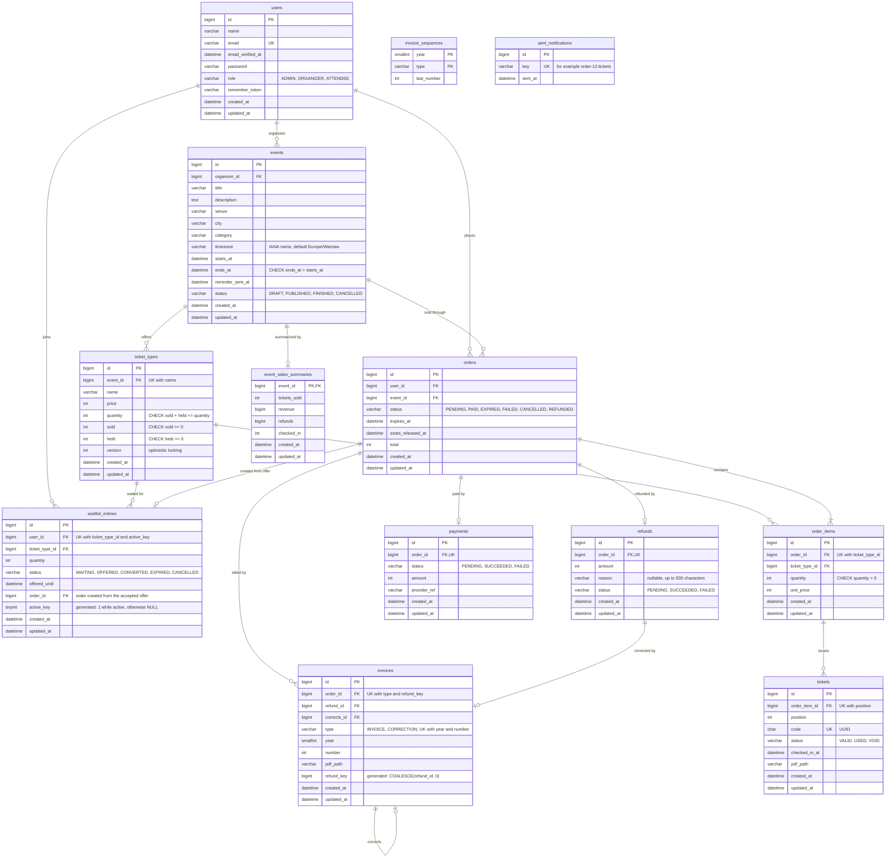

# Diagram ERD

Tabele frameworka (`sessions`, `cache`, `jobs`, `personal_access_tokens` itd.) są pominięte.
Kwoty są przechowywane jako liczby całkowite w groszach. Wszystkie daty to `DATETIME` w UTC.
Statusy i role są zabezpieczone ograniczeniami `CHECK` w bazie; opis w cudzysłowie przy kolumnie to dozwolone wartości.

`invoice_sequences` nie ma kluczy obcych: to licznik numeracji dla `invoices.number`, jeden wiersz na rok i typ.

## Reguły usuwania

| Klucz obcy | ON DELETE | Dlaczego |
|---|---|---|
| `events.organizer_id`, `orders.user_id`, `orders.event_id`, `waitlist_entries.user_id`, `waitlist_entries.order_id` | `RESTRICT` | historia sprzedaży zostaje |
| `order_items.ticket_type_id`, `tickets.order_item_id` | `RESTRICT` | sprzedane bilety zostają |
| `payments.order_id`, `refunds.order_id`, `invoices.*` | `RESTRICT` | dokumenty finansowe zostają |
| `ticket_types.event_id` | `CASCADE` | wydarzenie bez sprzedaży można usunąć razem z pulami |
| `order_items.order_id` | `CASCADE` | pozycje zamówienia bez biletów znikają razem z nim |
| `waitlist_entries.ticket_type_id`, `event_sales_summaries.event_id` | `CASCADE` | dane pochodne, bez wartości historycznej |
