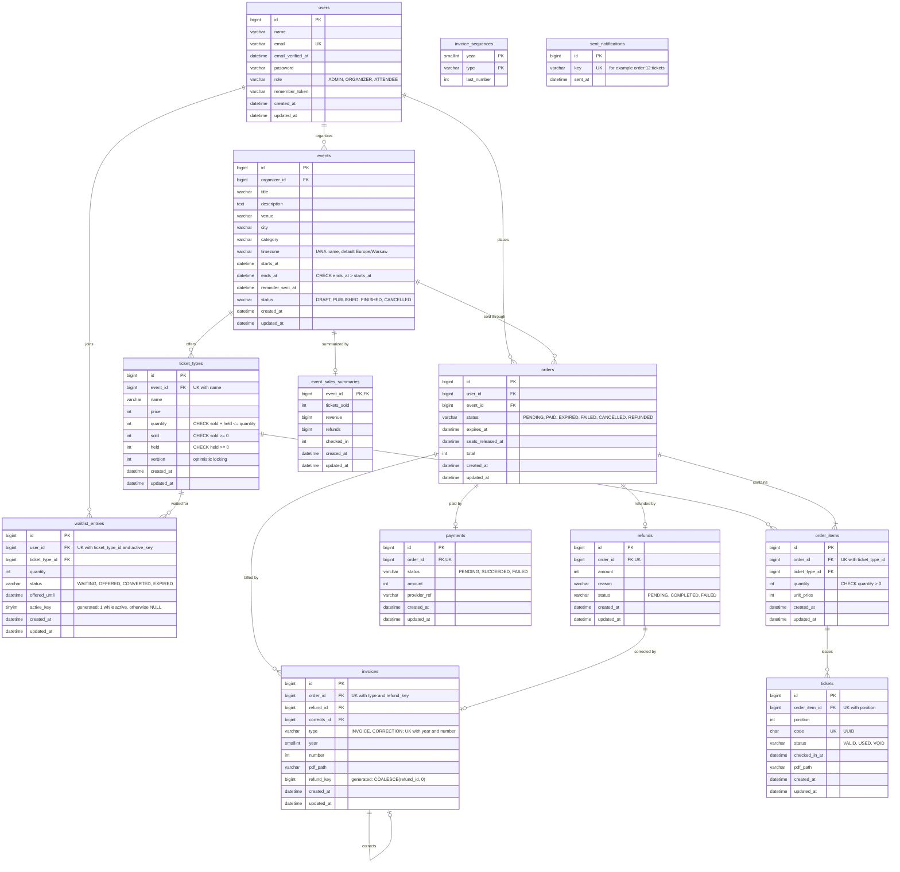

# Entity relationship diagram

Generated tables of the framework (`sessions`, `cache`, `jobs`, `personal_access_tokens`, ...) are left out.
Money is stored in integer grosze. All dates are `DATETIME` in UTC.

`invoice_sequences` has no foreign keys: it is the counter behind `invoices.number`, one row per year and type.

## Delete rules

| Foreign key | On delete | Why |
|---|---|---|
| `events.organizer_id`, `orders.user_id`, `orders.event_id`, `waitlist_entries.user_id` | `RESTRICT` | sales history stays |
| `order_items.ticket_type_id`, `tickets.order_item_id` | `RESTRICT` | sold tickets stay |
| `payments.order_id`, `refunds.order_id`, `invoices.*` | `RESTRICT` | financial records stay |
| `ticket_types.event_id` | `CASCADE` | an event without sales can be removed with its pools |
| `order_items.order_id` | `CASCADE` | items of an order without tickets go with it |
| `waitlist_entries.ticket_type_id`, `event_sales_summaries.event_id` | `CASCADE` | derived data without sales value |
